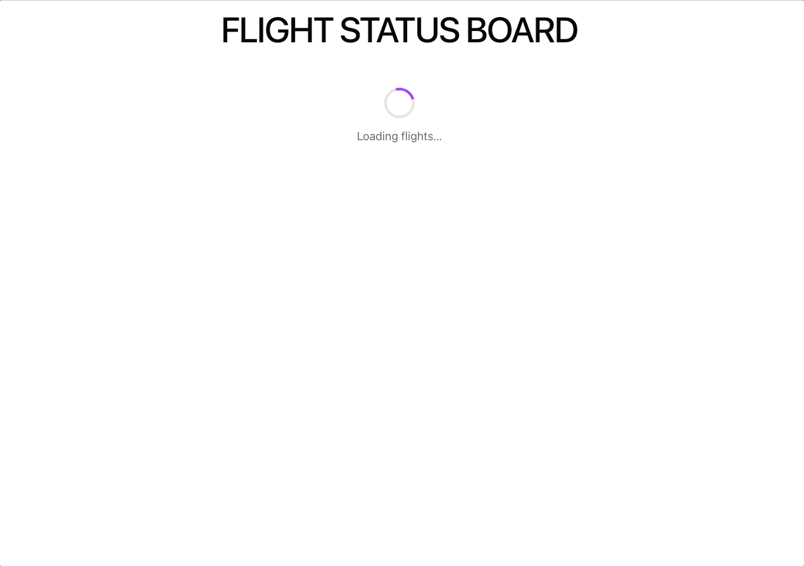

# Flight status board

React application that displays a flight status board for an airport.



Tech stack: Vite, React, TypeScript, Sass, Vitest + React Testing Library for testing

## Getting started

```bash
npm install
npm run dev    # start the dev server
npm test       # run the tests once
```

## Data source

Flights are built from the public [JSONPlaceholder posts API](https://jsonplaceholder.typicode.com/posts) (100 posts), mapped in [`src/domain/mapPostsToFlights.ts`](src/domain/mapPostsToFlights.ts):

- **Flight number**: `FL-{post.id}`
- **Destination**: first two words of the post title
- **Terminal**: `post.userId` (1-10)
- **Status, gate, departure time**: derived deterministically from `post.id`, so the same data always produces the same board

## Notes

- **Error states and failure simulation**

  The board handles initial loading, initial error, empty results, and stale data (a failed refresh keeps the last data visible). Data auto-refreshes every 30s and can be refreshed manually. Failures can be simulated in Chrome DevTools (Network -> Block request URL / Throttle request URL).

- **AI usage**

  Claude Code helped with component styling, tests, the deterministic data derivation and code review - always under my guidance, with clear requirements, and manually adjusted where necessary. I also used GitHub Copilot in VS Code, mostly for autocomplete. We can talk more about how I use AI in the presentation.
